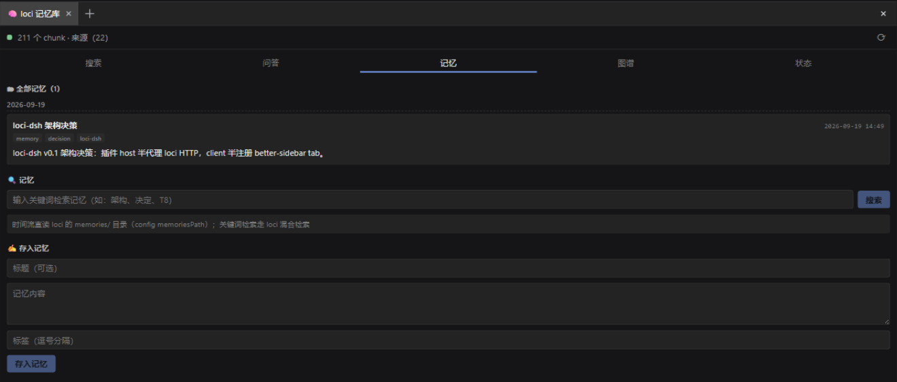

## Changelog

🗂 **Full memory timeline**: browse every loci memory chronologically, newest first.



- Day-grouped cards with title / tags / timestamp and expandable bodies (frontmatter parsed)
- Reads loci's `memories/` directory directly (the `YYYYMMDD-HHMMSS-<slug>.md` filename is the sort key) — mtime-cached, **no loci endpoint needed**, the same approach as the Graph view
- Enable with one config row:

```yaml
- id: loci-dsh
  config:
    memoriesPath: 'C:/path/to/loci/memories'
```

Keyword retrieval and quick capture are unchanged; saving a memory now refreshes the timeline instantly.

---

## 更新日志

🗂 **记忆全量时间流**：按时间倒序浏览每一条 loci 记忆。


- 按日分组的卡片，显示标题 / 标签 / 时间，正文可展开（解析 frontmatter）
- 直读 loci 的 `memories/` 目录（`YYYYMMDD-HHMMSS-<slug>.md` 文件名即排序键）——按 mtime 缓存，**不需要 loci 新增端点**，与图谱视图同一思路
- 一行配置开启：

```yaml
- id: loci-dsh
  config:
    memoriesPath: 'C:/path/to/loci/memories'
```

关键词检索与快速速记保持不变；保存记忆后时间流即时刷新。
